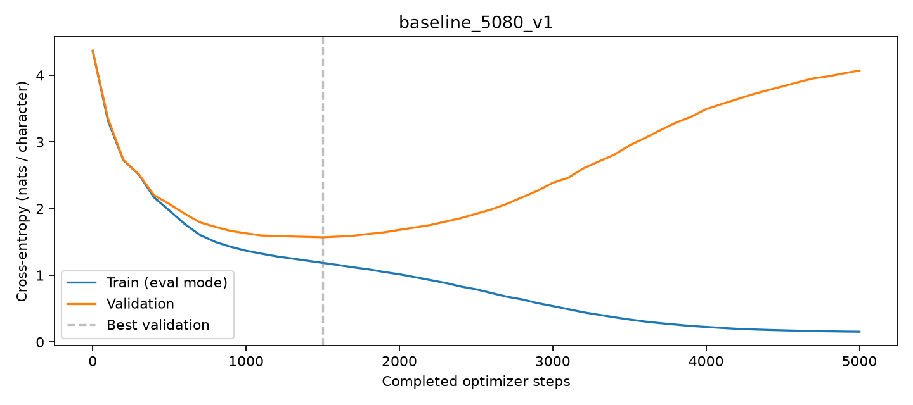
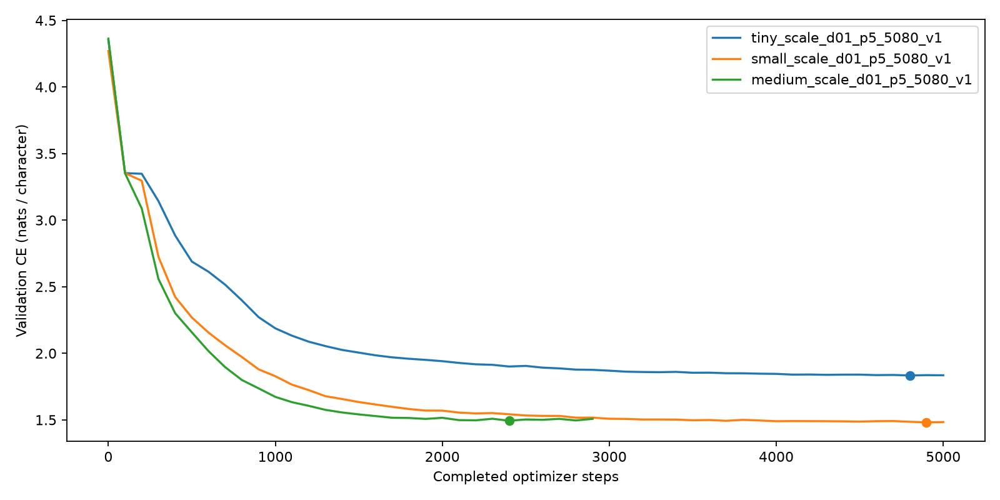
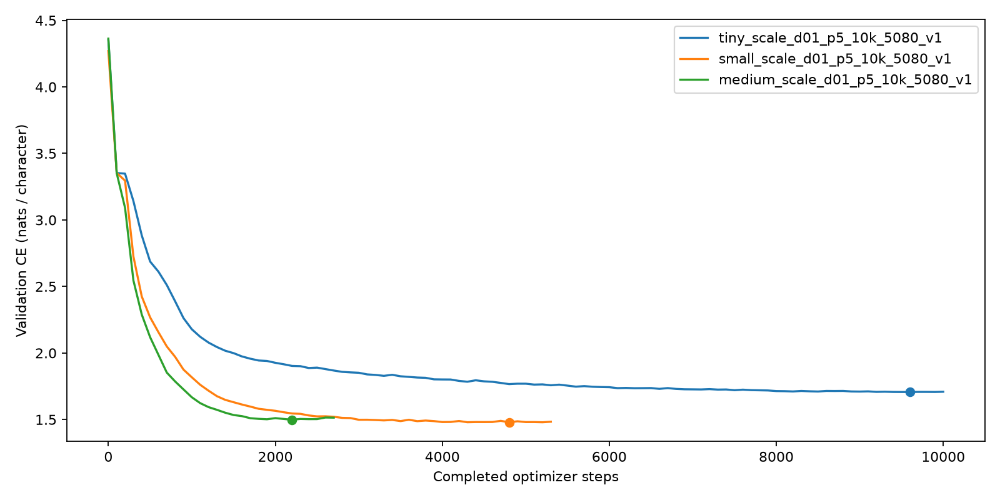
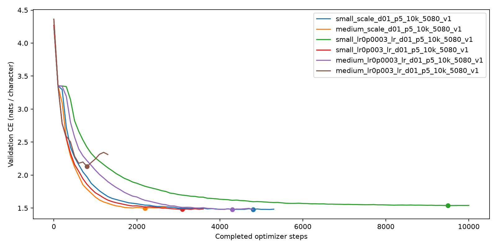
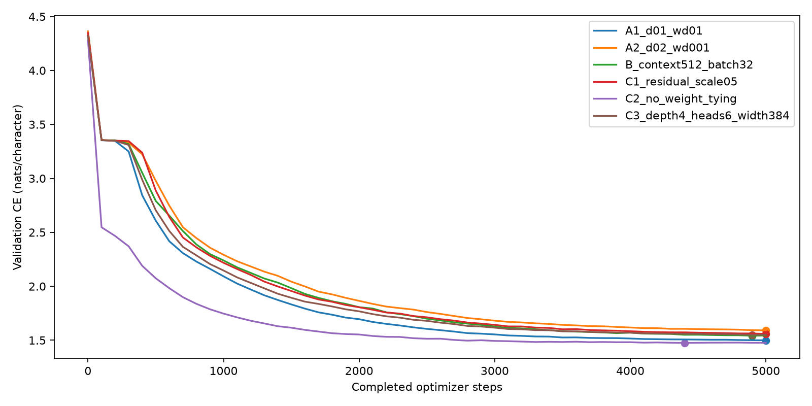

# Mini LLM: Shakespeare Text Generation

**Student:** Chenrui Liu

**Student ID:** a1984046

## 1. Data and model structure

This project implements a character-level GPT based on the supplied *llm-from-scratch* tutorial [1]. Its objective is next-character prediction, trained from scratch using cross-entropy loss. The Shakespeare dataset contains 65 distinct characters. The first 90% of the text forms the training set and the remaining 10% forms the validation set. Sampled windows remain within their respective splits. The vocabulary follows the tutorial and uses the complete text's character inventory.

The baseline has six Transformer blocks, six attention heads, an embedding dimension of 384, and a context length of 256 characters. Token embeddings are added to learned absolute positional embeddings. Each block applies pre-layer normalization, causal multi-head attention, a residual connection, and a second normalized residual sublayer containing a feed-forward network. The feed-forward network expands the embedding dimension by a factor of four and uses GELU. A final layer normalization precedes the output projection, which shares weights with the token embedding table.

Character tokenization keeps the vocabulary small but requires the model to learn spelling. The causal mask prevents access to future characters; the context length limits the available history. Residual connections and normalization support optimization, while the number and width of blocks determine model capacity and computational cost.

With width $d=384$, each head has width $d/6=64$. Each block uses $4d^2+4d$ parameters for the query, key, value, and output projections, $8d^2+5d$ for the two feed-forward layers, and $4d$ for its two layer normalizations. Including token and position embeddings and the final normalization, the total is $(65+256)d+6(12d^2+13d)+2d=10{,}770{,}816$. Weight tying avoids a second $65d$ parameter table for the output. The final model selected in Section 3.4 removes this tying, which adds $65d=24{,}960$ parameters for a total of 10,795,776.

## 2. Experimental design and modifications

The historical baseline completed 5,000 optimization steps. The initial size comparison used a maximum of 5,000 steps. The follow-up comparison uses a maximum of 10,000 steps and stops after five consecutive evaluations without a strictly lower validation loss. Evaluations occur every 100 completed updates, so five failures span 500 updates. A tie counts as a failure. All runs use batch size 64 and AdamW with weight decay 0.01. The learning rate increases to 0.001 over 100 warmup steps, then follows cosine decay toward 0.0001. The gradient norm is clipped at 1.0. The training seed is 42. The follow-up runs restart from random initialization because the cosine learning-rate horizon changes with the step ceiling. The 5,000-step runs remain recorded as a separate experiment. All reported losses are character-level cross-entropy (CE).

| Experiment | Layers / heads / width | Dropout | Hypothesis |
|---|---|---:|---|
| Baseline | 6 / 6 / 384 | 0 | Reference configuration |
| Tiny | 2 / 2 / 128 | 0.1 | Test lower capacity |
| Small | 4 / 4 / 256 | 0.1 | Test intermediate capacity |
| Medium | 6 / 6 / 384 | 0.1 | Test default size with regularization |

Dropout is added to embeddings, attention weights, and residual-branch outputs. The three size configurations change depth, head count, and width together. Their results describe overall configuration differences. The data, tokenizer, context length, batch size, learning-rate schedule, training seed, and evaluation windows are shared. Early stopping can produce different actual step and token budgets. All samples use each run's lowest-loss checkpoint. Medium also provides a comparison with the historical baseline at the same model size, with dropout and the stopping policy changed. The best-checkpoint selection rule is shared by both.

The baseline retains the tutorial's model and optimizer settings. The training implementation uses separate random-number generators for training and evaluation. At step 0 and every 100 completed steps through step 5,000, it estimates each split's loss over the same 20 batches in evaluation mode and records the aligned losses in JSON and CSV. It saves the checkpoint with the lowest observed validation loss for generation. It also saves the latest model, optimizer, and random-number generator states for resumption, along with the configuration and data fingerprint for compatibility checks. Validation is used for model selection, so an independent test set would be needed to estimate final generalization separately.

Generation uses Hamlet's first line, “To be, or not to be, that is the question:”, followed by a newline. Each continuation contains 800 new characters. Temperatures 0.6, 0.8, and 1.0 are compared with top-k fixed at 40 and seeds 42, 123, and 2026. Lower temperature concentrates the sampling distribution; higher temperature increases diversity. These settings affect generation rather than the checkpoint's validation loss. This protocol is used in Section 3.1; Section 3.5 uses a larger grid.

### Modifications to the tutorial code

The baseline and the size comparison use the settings described above. The later experiments change them as listed here. Each training change is a named setting in `GPTConfig` (`model.py`) or `TrainConfig` (`train.py`), so a run differs from the default only in the listed values.

| Modification | Setting | Motivation | Results |
|---|---|---|---|
| Dropout on embeddings, attention weights and residual branches | `dropout` | The baseline memorizes the training text | 3.1, 3.3 |
| Early stopping and best-checkpoint selection | `patience` | Stop when validation CE no longer improves | 3.1 |
| Model size | `n_layer`, `n_head`, `n_embd` | Match capacity to one million training characters | 3.1 |
| Peak learning rate | `max_lr`, `min_lr` | The suitable step size depends on the model | 3.2 |
| Weight decay | `weight_decay` | Penalize large weights | 3.3 |
| Longer context | `block_size` | Give attention more history | 3.3 |
| Residual branch scaling | `residual_scale` | Damp each block's update to the residual stream | 3.3 |
| Untied output projection | `weight_tying` | Separate the input embedding from the output classifier | 3.3 |
| Optimizer | `optimizer_name`, `momentum` | Compare AdamW with SGD and momentum | 3.3 |
| Second training seed and continued training | `seed`, parent checkpoint | Measure run-to-run variation and check convergence | 3.4 |
| Sampling grid | temperature, top-k | Trade diversity against errors | 3.5 |
| Word-level tokenizer | `tokenizer_type`, `word_data.py` | Remove the need to learn spelling | 3.6 |

The ablations in Section 3.3 share one protocol: the 6/6/384 model trained from random initialization for 5,000 steps with batch size 64, 150 warmup steps, cosine decay from 0.0003 to 0.00003, training seed 42, and no early stopping. Every run is scored on the same evaluation windows (context 256, batch 64, 20 batches), including the runs that train with a longer context or a smaller batch. The stages ran in sequence: regularization first, then context length, then architecture and optimizer changes relative to the chosen regularization, then a seed check and continued training of the best model. Earlier runs used a different warmup, schedule horizon and stopping rule, so comparisons across stages are indicative only.

## 3. Results and discussion

### 3.1 Baseline and model size

| Initial experiment | Parameters | Best CE | Best step | Actual steps | Character targets | Runtime |
|---|---:|---:|---:|---:|---:|---:|
| Historical baseline | 10,770,816 | 1.5701 | 1,500 | 5,000 | 81,920,000 | 294.2 s |
| Tiny | 437,888 | 1.8335 | 4,800 | 5,000 | 81,920,000 | 32.8 s |
| Small | 3,241,728 | 1.4818 | 4,900 | 5,000 | 81,920,000 | 132.3 s |
| Medium | 10,770,816 | 1.4939 | 2,400 | 2,900 | 47,513,600 | 219.8 s |

*In every loss figure the losses are evaluated every 100 steps and the points are joined by straight lines, so the first segment spans the steep initial drop between step 0 and step 100.*

The baseline ran on an NVIDIA RTX 5080 with PyTorch 2.11.0+cu128 from repository revision `cc08b02de2ab7a12c0d50af737ea24490f72862b`. It completed 5,000 optimizer steps and processed 81,920,000 character targets in sampled windows. The logged elapsed time includes evaluation through the last step. Validation cross-entropy fell from 4.3627 at initialization to 1.5701 nats per character at step 1,500. By step 5,000, training loss had fallen from 1.1861 to 0.1538, while validation loss rose to 4.0702. This divergence indicates overfitting on this split. The 51 evaluation points and both checkpoints are in `runs/baseline_5080_v1/`. All baseline samples use the step-1,500 checkpoint.

At temperature 0.8 with seed 42, the continuation begins “This quarrel for his death: but stood and body,” then includes “His deservate well his compassion,” and later introduces a speaker as “JOHN OF GARNT:”. The sample captures dialogue layout, recognizable words, and Shakespearean cues such as “thee.” The invented forms “deservate” and “nenly,” incomplete clauses, and the abrupt change of speaker show weaker spelling, syntax, and continuity. At the same seed, temperature 0.6 repeats “the” heavily in some lines, while temperature 1.0 produces forms such as “magred” and “nunss.” These observations describe individual samples. The full nine-sample grid and parameters are in `runs/baseline_5080_v1/samples_topk_40/`. Character-level training helps explain how recognizable local spelling patterns can coexist with invented words. During autoregressive generation the model conditions on its own sampled characters, and after 256 characters the earliest context is cropped, which limits access to the opening prompt.

The size comparison uses one training seed per configuration. The three generation seeds vary sampling only. Validation supports checkpoint and configuration selection. Further training seeds and independent evaluation would strengthen conclusions. GPU sharing with a Carla simulation was observed before this comparison, so recorded runtimes reflect the available resources during each run.

Tiny and Small reached the 5,000-step ceiling, with best checkpoints at steps 4,800 and 4,900. Medium reached its best CE of 1.4939 at step 2,400. Its validation losses at steps 2,500 through 2,900 all exceeded that value, triggering early stopping at step 2,900. The learning-rate schedule retained its original 5,000-step horizon. The stopping rule saved 2,100 planned updates in this run. A later improvement beyond the stopping point remains unobserved.

Small achieved the lowest observed validation CE, 1.4818, a reduction of 0.0884 from the historical baseline's best value. Its difference from Medium was only 0.0121, so a single training seed gives limited evidence for ranking these two configurations. Tiny's higher CE indicates weaker next-character predictions under this budget. Medium improved on the historical baseline at the same size and used dropout in training. Early stopping controls the amount of computation, while best-checkpoint selection was already available in the baseline. Comparison of the best observed checkpoints supports the combined experimental procedure, and additional runs would help isolate stochastic variation.

The following text observations use temperature 0.8, top-k 40, and seed 42 for every model, chosen as a fixed comparison setting. Tiny produces “This the shad is not dise the no,” with repeated function words, invented spellings, and fragmented line breaks. Small begins “Yet look upon my natural courtesy:” but later produces “And now no father eyes are deliver'd,” and invented forms including “Frunkage” and “winfer.” Medium produces recognizable phrases such as “God grant you” and “On my son-in-law!” alongside grammatical failures including “Having been do no dukedom?” Both Small and Medium show more recognizable local phrases than Tiny in these samples, while abrupt speaker changes and unstable meaning weaken continuity as a soliloquy. The original baseline also contains invented words and incomplete clauses. These examples support local qualitative observations, with all 27 new samples retained for inspection. The lower CE alone cannot establish an across-the-board improvement in literary quality.

The 10,000-step follow-up keeps dropout at 0.1 and patience at five evaluations. Each configuration was trained again from initialization with a cosine schedule planned over 10,000 steps. Thus the comparison with the first round changes both the permitted number of updates and the learning-rate trajectory.

| Follow-up configuration | Best validation CE | Best step | Stop step | Stop reason | Character targets | Runtime |
|---|---:|---:|---:|---|---:|---:|
| Tiny | 1.7070 | 9,600 | 10,000 | max_steps | 163,840,000 | 65.3 s |
| Small | 1.4793 | 4,800 | 5,300 | early_stopping | 86,835,200 | 139.9 s |
| Medium | 1.4986 | 2,200 | 2,700 | early_stopping | 44,236,800 | 204.4 s |

Tiny improved from 1.8335 to 1.7070, but reached the cap with four evaluations since its best point. Further improvement remains possible. Small stopped at step 5,300 after its best point at 4,800, achieving 1.4793. Medium stopped at step 2,700 after its best point at 2,200, achieving 1.4986. Their differences from the first round were small, with Medium slightly worse. At this learning rate Small is the better of the two; Section 3.2 shows that Medium needs a smaller rate. Its validation CE is 0.0908 lower than the original baseline's best CE and it uses 3,241,728 parameters. The actual training budgets differ under early stopping, and results use a single training seed.

At temperature 0.8 and seed 42, follow-up Small produces invented words including “restrainess” and “regroned,” as well as “What, has you would be,” which is grammatically unstable. Medium produces “To committedly we multitude them” and “we have standed.” These continuations still switch speakers and struggle to sustain the opening soliloquy. Section 3.5 compares the original baseline with the final model using the same prompt, length, temperatures, top-k values, and sampling seeds.

### 3.2 Learning rate

The size comparison used the tutorial's peak learning rate of 0.001 for every model. Small and Medium were retrained with peak rates of 0.0003 and 0.003, keeping dropout 0.1, weight decay 0.01, 100 warmup steps, cosine decay to one tenth of the peak over a 10,000-step horizon, and patience five.

| Model | Peak learning rate | Best validation CE | Best step | Stop step |
|---|---:|---:|---:|---:|
| Small | 0.0003 | 1.5387 | 9,500 | 10,000 |
| Small | 0.001 | 1.4793 | 4,800 | 5,300 |
| Small | 0.003 | 1.4807 | 3,100 | 3,600 |
| Medium | 0.0003 | 1.4796 | 4,300 | 4,800 |
| Medium | 0.001 | 1.4986 | 2,200 | 2,700 |
| Medium | 0.003 | 2.1294 | 800 | 1,300 |

The best rate depends on model size. Medium with 0.003 never trained properly: its best CE was 2.1294 at step 800 and early stopping ended the run at step 1,300. With 0.001 it reached its best point after only 2,200 steps and then began to overfit. With 0.0003 it improved for 4,300 steps and reached 1.4796, which matches Small's best result. Small tolerated the larger rates and was slowed by the smallest one, where its best point came at step 9,500 of 10,000. In these runs the deeper and wider model was the more sensitive to the peak rate, so all later Medium runs use 0.0003.

### 3.3 Regularization, context, architecture and optimizer

The reference run A1 uses dropout 0.1, weight decay 0.1, the tied output projection and AdamW under the protocol in Section 2. Each other row changes only the listed settings.

| Run | Change from A1 | Parameters | Best validation CE | Training CE at that step |
|---|---|---:|---:|---:|
| A1 | none (reference) | 10,770,816 | 1.4996 | 1.2175 |
| A2 | dropout 0.2, weight decay 0.01 | 10,770,816 | 1.5920 | 1.3572 |
| A3 | dropout 0.2 | 10,770,816 | 1.5930 | 1.3573 |
| B | context 512, batch 32 | 10,869,120 | 1.5418 | 1.3013 |
| C1 | residual branches scaled by 0.5 | 10,770,816 | 1.5587 | 1.3195 |
| C2 | untied output projection | 10,795,776 | 1.4753 | 1.1341 |
| C3 | four layers | 7,221,888 | 1.5501 | 1.3240 |
| C4 | SGD, momentum 0.9, rate 0.1 to 0.01 | 10,770,816 | 3.0460 | 3.0404 |

*Dropout and weight decay.* The baseline without dropout reached a training CE of 0.1538 while its validation CE rose to 4.0702, so it memorized the training text. Dropout 0.1 removes that divergence. Raising dropout to 0.2 made both training and validation CE worse within 5,000 steps: the model was still under-fitted when the budget ended. Changing weight decay between 0.01 and 0.1 at dropout 0.2 changed the validation CE by 0.0010, which is within run-to-run variation (Section 3.4). Dropout 0.1 and weight decay 0.1 were kept.

*Context length.* Doubling the context to 512 characters with the batch halved keeps the number of characters per update fixed. Scored on the common 256-character windows it was worse than A1 (1.5418 against 1.4996). Two further runs with the untied projection and context 512 reached 1.5547 (batch 16) and 1.7398 (batch 8 with dropout 0.2); these saw half and a quarter of the reference number of characters. Within this budget a longer context did not help next-character prediction.

*Residual scaling.* Multiplying each attention and MLP branch by 0.5 before adding it to the residual stream slowed learning (1.5587). The pre-normalized blocks already trained stably at six layers, so damping the branches only cost progress.

*Untied output projection.* The tutorial shares one $65\times d$ matrix between the token embedding and the output projection. Giving the output its own matrix adds 24,960 parameters and gave the lowest CE of any run, 1.4753, an improvement of 0.0243 over A1. With only 65 tokens the saving from tying is negligible, and the two roles can differ: the embedding describes a character as context, while the output row scores it as a prediction.

*Depth.* Removing two layers gave 1.5501 with a higher training CE than A1, so the four-layer model was under-fitted at this learning rate and budget. This agrees with Section 3.2, where the smaller model needed a larger rate.

*Optimizer.* SGD with momentum at one tuned setting reached only 3.0460 in the same budget. A single setting does not show that AdamW is required, but it shows how much the adaptive step sizes help at this budget.

### 3.4 Final model, seed variation and continued training

The final model is C2: six layers, six heads, width 384, context 256, dropout 0.1, an untied output projection, AdamW with weight decay 0.1, and a peak learning rate of 0.0003. It has 10,795,776 parameters and trained in 383 s on the RTX 5080. Its best validation CE is 1.4753 at step 4,400, where the training CE is 1.1341. The baseline's best was 1.5701, so the validation CE fell by 0.0948 nats per character and the per-character perplexity fell from 4.81 to 4.37. At step 5,000 the validation CE is still 1.4762, whereas the baseline had risen to 4.0702 by then.

Repeating C2 with training seed 73 gave 1.4791, a difference of about 0.004 from seed 42. Differences of this size between configurations should therefore not be ranked. In particular, Small at learning rate 0.001 (1.4793 with 3,241,728 parameters) is indistinguishable from the final model on this evidence. Medium was kept because the ablations and samples were produced with it. Small reaches the same CE with about 30% of the parameters, and its 5,300-step run took 140 s.

Continued training tested whether C2 had converged. Its best checkpoint was reloaded with a fresh AdamW state and trained for 1,000 more steps at batch size 16, with the rate warmed up to 0.0002 and decayed to 0.00002. The validation CE first rose to 1.5081 at step 300 and returned to 1.4752 at step 1,000, a change of 0.0001 from the start. A second continuation at rate 0.0001 never improved on its starting point and stopped after 500 steps. The model had converged for this configuration. The remaining gap between training CE (1.13) and validation CE (1.48) points to the amount of data, rather than to optimization, as the limit. The generated samples below use the continued checkpoint, whose CE of 1.4752 is practically the same as C2's.

### 3.5 Sampling: temperature and top-k

Sampling parameters were compared on the baseline and the final model with identical inputs: the prompt “To be, or not to be, that is the question:”, 400 new characters, 20 sampling seeds per setting, top-k of 5 and 10, and temperatures 0.6, 0.8, 1.0 and 1.2. Every sample is kept in `generated_text/`. Three statistics summarize each setting: the share of generated words that never occur in the corpus (invented words), the share of adjacent word pairs that occur in the training text (seen pairs), and the ratio of distinct words to all words in a sample. Twenty 400-character excerpts of the validation text give reference values of 51.1% for seen pairs and 0.745 for the distinct-word ratio.

| Temperature | Top-k | Invented words, baseline | Invented words, final | Seen pairs, final | Distinct ratio, final |
|---:|---:|---:|---:|---:|---:|
| 0.6 | 5 | 2.6% | 0.4% | 80.4% | 0.617 |
| 0.8 | 5 | 4.0% | 1.3% | 71.9% | 0.693 |
| 1.0 | 5 | 6.2% | 1.8% | 70.4% | 0.713 |
| 1.2 | 5 | 9.7% | 3.3% | 61.0% | 0.768 |
| 0.6 | 10 | 3.4% | 1.3% | 76.6% | 0.657 |
| 0.8 | 10 | 6.0% | 1.8% | 68.5% | 0.725 |
| 1.0 | 10 | 9.5% | 4.6% | 56.7% | 0.790 |
| 1.2 | 10 | 14.7% | 7.7% | 48.9% | 0.813 |

The final model invents fewer words than the baseline at every setting, by a factor between about two and six. At temperature 0.8 and top-k 10 with seed 1, the baseline writes “Third George of Bustistands” and “thire of this bear-mellow” and labels a speaker “Second Watesman”. The final model writes “Suppose he is but all that may by himself / But to call him that were in this point wont” and then introduces “KING RICHARD III:”. Its words are real and its lines have the shape of verse, but the clause has no clear meaning. The lower validation CE therefore shows up mainly as better spelling.

Temperature divides the logits before the softmax, so a low temperature concentrates probability on the most likely characters and a high one flattens the distribution. At 0.6 the final model almost never misspells, but it repeats common phrases: 80% of its word pairs occur in the training text against 51% for real text, and its distinct-word ratio is below that of real text. At 1.2 its diversity exceeds real text and invented words reach 3.3% to 7.7%. Top-k removes all but the k most likely characters. Because a misspelling usually starts with an unlikely character, the smaller k cuts invented words at every temperature, for example from 4.6% to 1.8% at temperature 1.0, at the cost of some diversity. Temperature 0.8 with top-k 10 gives a distinct-word ratio of 0.725, close to real text, with 1.8% invented words, and is the setting used for the examples in this section.

### 3.6 Word-level tokenization

A character model must learn spelling before anything else. As an alternative, the corpus was split into whole words, punctuation marks and whitespace runs. Words seen at least twice in the training split, together with all punctuation and whitespace tokens, form a vocabulary of 7,122 tokens; other words map to `<unk>`. The model keeps the final configuration (6/6/384, untied projection, dropout 0.1, weight decay 0.1, peak rate 0.0003) and has 16,215,552 parameters because of the larger embedding and output tables. Gradient accumulation over micro-batches of 8 keeps the effective batch at 64.

Training stopped early at step 2,500 with the best validation CE of 2.7042 nats per token at step 2,000. By step 2,500 the training CE had fallen to 1.9080 while the validation CE had risen to 2.7336. The training split contains only 410,117 word-level tokens, so this model overfits sooner than the character model. Its CE cannot be ranked against the character CE: the unit is a token rather than a character, a 256-token context covers more text, and `<unk>` replaces 9.0% of validation words, so predicting `<unk>` is not predicting the word.

The sampling grid of Section 3.5 was applied to the word model.

| Temperature | Top-k | `<unk>` share of word positions | Seen pairs | Distinct ratio |
|---:|---:|---:|---:|---:|
| 0.6 | 5 | 13.1% | 95.2% | 0.399 |
| 0.8 | 5 | 15.6% | 93.3% | 0.417 |
| 1.0 | 5 | 14.9% | 92.7% | 0.471 |
| 1.2 | 5 | 9.4% | 91.0% | 0.467 |
| 0.6 | 10 | 10.5% | 94.2% | 0.440 |
| 0.8 | 10 | 13.3% | 91.0% | 0.488 |
| 1.0 | 10 | 10.0% | 91.3% | 0.542 |
| 1.2 | 10 | 7.6% | 89.2% | 0.568 |

The word model cannot misspell, and its short exchanges read naturally, for example “My lord, I am not a subject born of York.” Two defects outweigh this. `<unk>` fills 8% to 16% of word positions and appears in at least 18 of the 20 samples at every setting, as in “And by the `<unk>`: I will not be a `<unk>` man.” The text is also far more repetitive than real text: about 90% of its word pairs occur in the training text and its distinct-word ratio is 0.40 to 0.57 against 0.745, with lines such as “For I am a king, I am a king”. With a 7,122-token vocabulary, top-k 5 or 10 keeps under 0.2% of the candidates, so sampling stays on the most frequent words. Unlike the character model, the word model gains diversity from a higher temperature without any spelling cost, and its `<unk>` share is lowest at temperature 1.2. Masking `<unk>` during sampling removes it from the output but leaves the repetition unchanged (distinct ratio 0.41 to 0.57). On this corpus the character model gives text whose statistics are closer to real English, so it remains the final model. A sub-word tokenizer, which keeps a closed vocabulary without `<unk>`, is the natural next step.

### 3.7 Resemblance to real English and limitations

The final model's text resembles Shakespearean English in its surface form. Most words are real, common function words appear in plausible order, speaker labels and line breaks follow the layout of a play, and many lines have the length of a verse line. These are the patterns that next-character prediction over a 256-character window rewards, since each depends on the previous few characters or words.

It does not resemble English above the level of a phrase. Clauses lose their grammar after a few words, speakers change without reason, and no topic is sustained, so the continuation never reads as a soliloquy. The corpus does not contain *Hamlet*, so the opening line is new to the model and it can only continue in the general style of the plays it saw. Three choices explain most of this. Character-level tokens make spelling something the model has to learn, which is why invented words appear and why they multiply at higher temperature. A context of 256 characters is fewer than 50 words, so nothing earlier can influence the text. And the training split holds about one million characters, which a ten-million-parameter model can memorize: regularization and tuning moved the validation CE from 1.57 to 1.48, but the gap to the training CE remains.

Validation CE was used to choose every setting, so it is not an independent estimate of generalization, and most configurations were trained with a single seed.

## 4. Attention and positional encoding

For unmasked attention, define

$$
A(X)=\operatorname{softmax}(S)V,\qquad
S=\frac{QK^\top}{\sqrt{d_k}},\qquad
Q=XW_Q,\ K=XW_K,\ V=XW_V.
$$

Let $P$ be a permutation matrix. For input $PX$, the projections become $PQ,PK,PV$, and the score matrix becomes $PSP^\top$. Row-wise softmax commutes with simultaneous row and column permutation because reordering leaves each row's normalization denominator unchanged. Hence

$$
\operatorname{softmax}(PSP^\top)
=P\operatorname{softmax}(S)P^\top,
$$

and therefore

$$
A(PX)=P\operatorname{softmax}(S)P^\top PV=PA(X).
$$

Thus unmasked self-attention is permutation equivariant.

With fixed positional encoding $E$, define $F(X)=A(X+E)$. A counterexample shows that this property no longer holds generally. Take two positions, scalar embeddings, $W_Q=W_K=W_V=1$, $X=(0,0)^\top$, and $E=(0,1)^\top$. Direct calculation gives

$$
F(X)=\begin{pmatrix}1/2\\ e/(1+e)\end{pmatrix}.
$$

If $P$ swaps the positions, then $PX=X$, so $F(PX)=F(X)$. However, $PF(X)$ swaps two unequal entries. Consequently $F(PX)\ne PF(X)$. Fixed absolute positional encodings therefore remove the general equivariance guarantee.

The proof assumes unmasked attention. If attention instead adds a mask $M$ to the logits, permuting the input and the mask together preserves equivariance, because the new logits are $P(S+M)P^\top$. Keeping the mask fixed gives $PSP^\top+M$, so the same proof requires $PMP^\top=M$. A fixed causal mask allows position 2 to attend to position 1 while excluding the reverse edge. Swapping the two positions changes the permitted edges. For example, with two scalar tokens $(0,1)^\top$, $W_Q=W_K=0$ and $W_V=1$, causal attention averages each available prefix and returns $(0,1/2)^\top$. Feeding the swapped input returns $(1,1/2)^\top$, which differs from the swapped original output $(1/2,0)^\top$.

## Reference

[1] angelos-p. *Train Your Own LLM From Scratch*, Parts 1–5, revision `63069f99af8ce9a6ab6e261000f4f9f1daaa1ee9`. [Source repository](https://github.com/angelos-p/llm-from-scratch/tree/63069f99af8ce9a6ab6e261000f4f9f1daaa1ee9)
