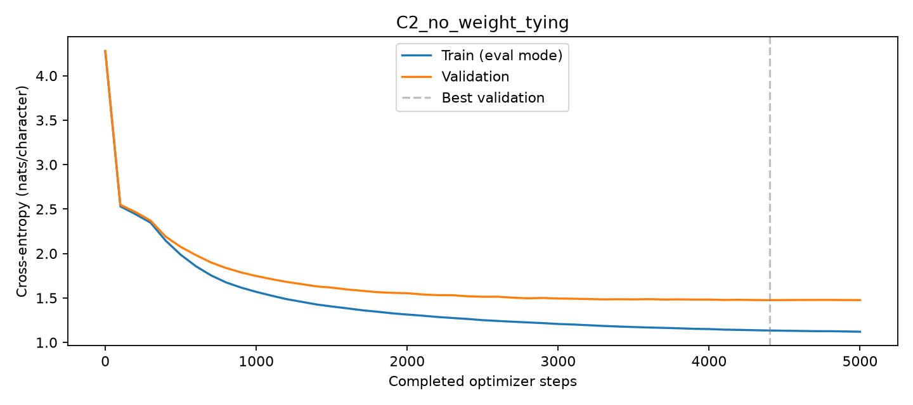

# Mini LLM: Shakespeare Text Generation

**Student:** Chenrui Liu

**Student ID:** a1984046

## 1. Model structure

The model is the character-level GPT of the *llm-from-scratch* tutorial [1], trained from scratch to predict the next character. The Shakespeare file has 65 distinct characters; the first 90% (1.0 million characters) is the training split and the last 10% the validation split. All losses are cross-entropy (CE) in nats per character on the validation split.

Each character is mapped to a token embedding, to which a learned positional embedding is added. The result passes through a stack of Transformer blocks. A block applies layer normalization, causal multi-head self-attention and a residual connection, then layer normalization, a feed-forward network of four times the width with GELU, and a second residual connection. A final layer normalization and a linear layer give a score for each of the 65 characters.

| Choice | Baseline (tutorial) | Final model | What it controls |
|---|---|---|---|
| Tokens | characters | characters | Small vocabulary, but spelling has to be learned |
| Context length | 256 | 256 | How much earlier text can influence a prediction, fewer than 50 words |
| Layers / heads / width | 6 / 6 / 384 | 4 / 4 / 256 | Capacity |
| Parameters | 10,770,816 | 3,258,368 | |
| Output projection | tied to the embedding | untied | Whether one matrix serves as input embedding and output classifier |
| Dropout | 0 | 0.1 | Regularization |
| Weight decay | 0.01 | 0.1 | Regularization |
| Checkpoint used | best validation CE | best validation CE, early stopping | When training ends |

The causal mask lets a position attend only to earlier positions. Training can therefore score all 256 positions of a window at once with the true text as input, while generation must feed the model its own sampled characters. Both models use AdamW with a peak learning rate of 0.001, 100 warmup steps, cosine decay, gradient clipping at 1.0 and batch size 64. Every setting is a named field of `GPTConfig` or `TrainConfig`, and each modification is marked by a comment in the code.

## 2. Improvements

| Step | Model | Validation CE |
|---|---|---:|
| Baseline | 6 / 6 / 384, tutorial settings | 1.5701 |
| 1 | + dropout 0.1 and early stopping | 1.4986 |
| 2 | Smaller model, 4 / 4 / 256 | 1.4793 |
| 3 | + untied output projection and weight decay 0.1 (final model), three seeds | 1.4648, 1.4762, 1.4696 |
| For comparison | 6 / 6 / 384 with the same changes and peak learning rate 0.0003, three seeds | 1.4753, 1.4791, 1.4848 |

**What was lacking.** The baseline memorizes the training text. Its validation CE is lowest at step 1,500 (1.5701); by step 5,000 the training CE has fallen to 0.15 while the validation CE has risen to 4.07.

**Step 1, regularization.** Dropout on the embeddings, attention weights and residual branches, together with stopping once the validation CE no longer improves, removes the divergence and lowers the CE to 1.4986. This follows the lectures on generalization: overfitting is the dominant source of error here, and dropout and early stopping reduce it.

**Step 2, model size.** With one million training characters a model of 3.2 million parameters does at least as well as one of 10.8 million (1.4793). The larger model only matched this after its peak learning rate was lowered to 0.0003; at 0.003 it failed to train (2.13). The suitable step size depends on the model, as the lectures on optimization suggest.

**Step 3, output projection and weight decay.** The tutorial shares one 65 × width matrix between the token embedding and the output layer. Giving the output layer its own matrix costs 16,640 parameters and lets the two roles differ: one describes a character as context, the other scores it as a prediction. On the 6 / 6 / 384 model this alone lowered the CE from 1.4996 to 1.4753. On the small model, untying alone gained 0.005 and weight decay 0.1 alone 0.007, and together they gave the final model.

**How reliable the differences are.** Runs that differ only in the random seed vary by up to 0.011. The final model (mean 1.4702) and the larger tuned model (mean 1.4797) therefore cannot be ranked by CE, and the smaller one was chosen because it has 30% of the parameters. The gain over the baseline, 0.10 nats per character (per-character perplexity 4.81 to 4.35), is about nine times the seed variation.

**What did not help.** Dropout 0.2 (1.59), a context of 512 characters (1.54), scaling the residual branches by 0.5 (1.56) and SGD with momentum instead of AdamW (3.05) were all worse than the reference they were tested against (1.50), and training a converged model for longer changed nothing. The remaining gap between training CE (1.13) and validation CE (1.47) points to the amount of data as the limit. A follow-up experiment in the appendix confirms this: with 4.4 times more Shakespeare text the same models reach 1.29 to 1.33.

## 3. Generated text

The prompt is the first line of Hamlet's soliloquy, “To be, or not to be, that is the question:”. Each setting was sampled with 20 seeds and 400 new characters. The table uses top-k 10 and reports the share of generated words that do not occur anywhere in the corpus, and the ratio of distinct words to all words in a sample, which is 0.745 for real held-out text.

| Temperature | Invented words, baseline | Invented words, final | Distinct-word ratio, final |
|---:|---:|---:|---:|
| 0.6 | 3.4% | 1.3% | 0.661 |
| 0.8 | 6.0% | 3.0% | 0.742 |
| 1.0 | 9.5% | 4.4% | 0.766 |
| 1.2 | 14.7% | 7.9% | 0.822 |

At temperature 0.8 the final model begins “Suppose of the sun that I will be my soul, / That invirced in the story and some comfort”, while a baseline sample contains the invented words “serivity” and “stopherd”. The final model invents roughly half as many words as the baseline, or fewer, at every setting, so the lower CE shows up mainly as better spelling.

**Temperature and top-k.** Temperature divides the scores before the softmax. At 0.6 the model rarely misspells but repeats common phrases, and its vocabulary is less varied than real text. At 1.2 it is more varied than real text and 7.9% of its words are invented. Top-k keeps only the k most likely characters; because a misspelling usually begins with an unlikely character, lowering k from 10 to 5 cuts invented words from 4.4% to 2.3% at temperature 1.0. Temperature 0.8 with top-k 10 matches the variety of real text most closely.

**How the text resembles English.** Most words are real, function words appear in plausible order, speaker labels and line breaks follow the layout of a play, and many lines have the length of a verse line. Each of these depends only on the previous few characters or words, which is what next-character prediction over a short window rewards.

**How it does not.** Clauses lose their grammar after a few words, speakers change without reason and no topic is sustained, so the continuation never reads as a soliloquy. The choices in Section 1 explain this:

- Character tokens make spelling something to be learned, hence the invented words, and more of them at higher temperature.
- A context of 256 characters is fewer than 50 words, so nothing earlier can shape the text.
- One million characters is little data. *Hamlet* is not in the corpus, so the model can only continue in the general style of the plays it saw.
- The model is trained on true text but generates from its own samples, so an early slip is carried forward.

A word-level tokenizer was also tried. It cannot misspell, but 8% to 16% of its word positions were the unknown-word token and its text was far more repetitive (distinct-word ratio 0.40 to 0.57), so the character model was kept.

## 4. Attention and positional encoding

The lecture on attention uses the scaled dot-product form of Vaswani et al. [2], $\mathrm{Attention}(Q,K,V)=\mathrm{softmax}(QK^\top/\sqrt{d_k})\,V$. In self-attention the queries, keys and values are linear maps of the same input $X$, which has one row per position. For unmasked self-attention, define

$$
A(X)=\mathrm{softmax}(S)V,\qquad
S=\frac{QK^\top}{\sqrt{d_k}},\qquad
Q=XW_Q,\ K=XW_K,\ V=XW_V.
$$

**Claim.** $A(PX)=PA(X)$ for every permutation matrix $P$.

**Proof.** For input $PX$ the projections become $PQ$, $PK$, $PV$, so the score matrix becomes $PQ(PK)^\top/\sqrt{d_k}=PSP^\top$. The softmax acts on each row separately, and permuting the entries of a row does not change its normalizing sum, so

$$
\mathrm{softmax}(PSP^\top)=P\,\mathrm{softmax}(S)\,P^\top .
$$

Since $P^\top P=I$,

$$
A(PX)=P\,\mathrm{softmax}(S)\,P^\top PV=P\,\mathrm{softmax}(S)\,V=PA(X).
$$

**With a positional encoding the property fails.** Let $E$ be a fixed positional encoding and $F(X)=A(X+E)$. Take two positions, scalar embeddings, $W_Q=W_K=W_V=1$, $X=(0,0)^\top$ and $E=(0,1)^\top$. Then $X+E=(0,1)^\top$, the score matrix has rows $(0,0)$ and $(0,1)$, and

$$
F(X)=\begin{pmatrix}1/2\\ e/(1+e)\end{pmatrix}.
$$

Let $P$ swap the two positions. Then $PX=X$, so $F(PX)=F(X)$, while $PF(X)$ has its two unequal entries exchanged. Hence $F(PX)\ne PF(X)$: once a fixed positional encoding is added, the input is no longer treated equivariantly, which is what allows the model to use word order.

The proof concerns unmasked attention. The causal mask of the GPT is also fixed to positions and breaks the property for the same reason.

## Further material

`results/all_runs.csv` lists all 41 training runs. `Experiments_Detailed.md` describes every experiment, including the learning-rate comparison, the single-change controls and the word-level tokenizer. `appendix_more_data/` reports the follow-up with more training text. `generated_text/` holds every generated sample.

## References

[1] angelos-p. *Train Your Own LLM From Scratch*, Parts 1–5, revision `63069f99af8ce9a6ab6e261000f4f9f1daaa1ee9`. [Source repository](https://github.com/angelos-p/llm-from-scratch/tree/63069f99af8ce9a6ab6e261000f4f9f1daaa1ee9)

[2] A. Vaswani, N. Shazeer, N. Parmar, J. Uszkoreit, L. Jones, A. N. Gomez, Ł. Kaiser and I. Polosukhin. *Attention Is All You Need*. NeurIPS 2017.
