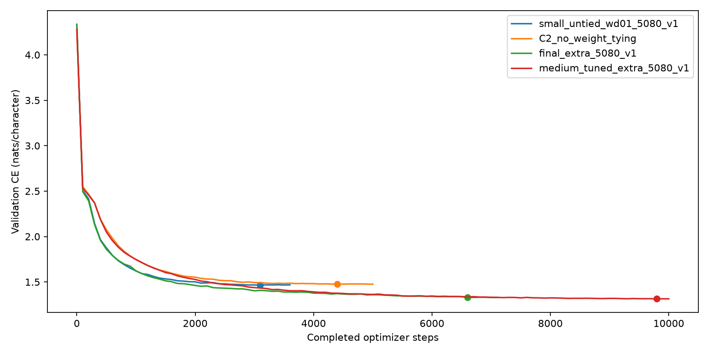

# Appendix: More Training Text

**Student:** Chenrui Liu

**Student ID:** a1984046

This appendix is a follow-up to the report *Mini LLM: Shakespeare Text Generation*. The report and its notebook use the original Shakespeare file only. Here the same models are retrained with more Shakespeare text.

Sections 3.3 and 3.4 of the report point to the amount of data as the limit, and the tutorial lists better data as the first idea to explore. To test this, more Shakespeare was added to the training split. The source is the Project Gutenberg edition of the complete works [1]. The nine plays already in the corpus were left out, so that no validation text enters training, and so was *Hamlet*, so that the prompt remains unseen. The sonnets and narrative poems were left out because they are not dialogue. The remaining 28 plays were converted to the layout and the 65-character vocabulary of the original file (`experiments/extended_data/prepare_extended_data.py` in the repository): speaker labels with a colon, no stage directions or scene headings. As a check of the conversion, *Coriolanus* exists in both sources: after conversion its layout matches, and 52.6% of its lines are identical to lines of the original file, the rest differing by edition in punctuation, spelling and line breaks.

The extra text has 3,417,581 characters, so the training split grows from 1,003,854 to 4,421,435 characters (4.4 times). The validation split and the evaluation windows are unchanged, so the validation CE is directly comparable with the report. Small tuned was trained exactly as before. Medium tuned was given a 10,000-step schedule instead of 5,000 because of the larger text.

| Model | Seed 42 | Seed 73 | Mean | Mean on the original text |
|---|---:|---:|---:|---:|
| Small tuned | 1.3286 | 1.3041 | 1.3163 | 1.4702 |
| Medium tuned | 1.3143 | 1.2882 | 1.3012 | 1.4797 |

More text lowered the validation CE by 0.15 for Small and 0.18 for Medium. This is more than all the tuning in Sections 3.1 to 3.4 of the report together, which gained about 0.10 over the baseline. The gap between training and validation CE of Medium tuned shrank from 0.34 to 0.17. Medium is now lower than Small by 0.0151 on average, where it was higher on the original text, which is the direction expected when data stops being the only limit. The two seeds of one model still differ by up to 0.0261, so two seeds do not establish a ranking. Three of the four runs reached their best checkpoint within the last 200 of 10,000 steps, so they had not converged; the seed-42 run of Small was ended by early stopping at step 7,100, when its CE was still within 0.001 of its best. The lowest validation CE in this project is 1.2882, from Medium tuned with the extra text.

The sampling grid of Section 3.5 of the detailed experiment log was repeated for the seed-42 runs, scoring every model against the original and the extra text together. With top-k 10:

| Temperature | Invented words, final model | Small tuned + extra text | Medium tuned + extra text |
|---:|---:|---:|---:|
| 0.6 | 1.2% | 0.5% | 0.2% |
| 0.8 | 2.8% | 1.7% | 0.7% |
| 1.0 | 4.0% | 2.0% | 2.0% |
| 1.2 | 7.2% | 4.3% | 4.4% |

Both models trained on more text invent fewer words than the final model at all eight settings. All samples are in `generated_text/`. Their longest verbatim copies of training text average about 20 characters, the same as for real held-out text (20), so the improvement is not memorization. At temperature 0.8 and top-k 10 with seed 1, Medium with the extra text begins “Saw such as the cause that may be made and win the / ladder of all my friendship.” The words are real, but the sentence still has no clear meaning: more data improves spelling and local phrasing before it improves sense.

The word-level tokenizer was also retrained on the larger text, on both architectures. Its vocabulary grows from 7,122 to 17,675 tokens and the share of validation words outside it falls from 9.0% to 4.2%.

| Word-level model | Parameters | Seed 42 | Seed 73 | Stop step |
|---|---:|---:|---:|---:|
| Medium tuned architecture | 24,320,256 | 2.6826 | 2.6852 | 5,200 / 5,300 |
| Small tuned architecture | 12,274,688 | 2.7465 | 2.7320 | 2,900 / 3,200 |

These values are in nats per token and cannot be compared with the character models, nor with the word model of Section 3.6 of the detailed experiment log, whose vocabulary is different. Within this table the larger architecture is better by about 0.06 with both seeds, a clearer effect of model size than at character level. All four runs stopped early with a training CE near 2.1 against a validation CE near 2.7, so the word models still overfit. In the samples of the larger word model `<unk>` fills only 0.4% to 1.5% of word positions, against 8% to 16% in Section 3.6 of the detailed experiment log, and for the smaller one 3.0% to 6.5%. Its lines can read well, for example “The time of our love is the time of men / And every one blazing in the court of heaven.” The repetition remains: the distinct-word ratio is 0.44 to 0.59 against 0.745 for real text. More data therefore removes most of the `<unk>` problem but not the tendency of top-k sampling over a large vocabulary to stay on frequent words.

The final model and all results in the report use the original text only. The result of this appendix is that, for this task, more text of the same kind is worth more than any change to the model.

## Files

| Path | Content |
|---|---|
| `more_data_comparison.png` | Validation curves with and without the extra text |
| `generated_text/extended_data/` | 20 samples per sampling setting for each model trained with the extra text, in folders named after the model and its training settings, with the statistics quoted above |
| `results.csv` | Best validation CE, stop step and parameters of the eight runs |
| `../experiments/extended_data/prepare_extended_data.py` | Downloads the source and builds the extra text |
| `../experiments/extended_data/train_with_extended_data.py` | Trains a model with the extra text |

## Reference

[1] William Shakespeare. *The Complete Works of William Shakespeare*. Project Gutenberg ebook 100. [Project Gutenberg](https://www.gutenberg.org/ebooks/100)
